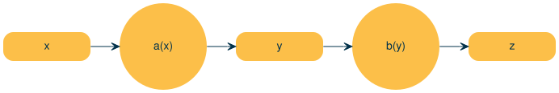
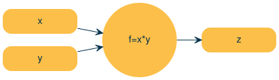
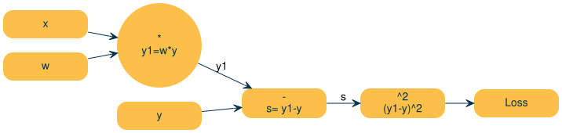
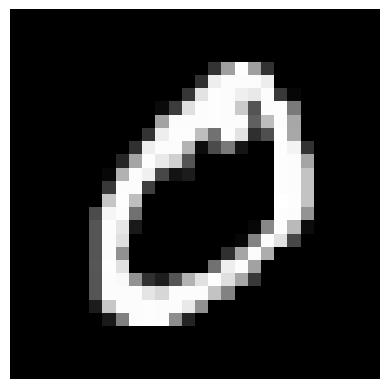
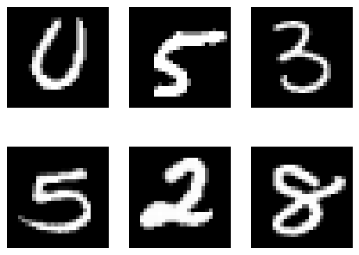

# Model Training Loop

Model Training Loop

Author

Benedict Thekkel

``` python
import torch
```

``` python
x = torch.randn(3, requires_grad = True)
```

``` python
print(x)
```

    tensor([-1.2561, -3.5029, -1.4459], requires_grad=True)

``` python
y = x + 2
y.retain_grad()
```

``` python
z = y * y*2
z.retain_grad()
z = z.mean()
print(z)
```

    tensor(2.0794, grad_fn=<MeanBackward0>)

``` python
z.backward(retain_graph=True)
```

``` python
x,y, z
```

    (tensor([-1.2561, -3.5029, -1.4459], requires_grad=True),
     tensor([ 0.7439, -1.5029,  0.5541], grad_fn=<AddBackward0>),
     tensor(2.0794, grad_fn=<MeanBackward0>))

``` python
x.grad, y.grad
```

    (tensor([ 0.9919, -2.0039,  0.7388]), tensor([ 0.9919, -2.0039,  0.7388]))

## For multiple z values

``` python
import torch
```

``` python
x = torch.randn(3, requires_grad = True)
```

``` python
print(x)
```

    tensor([-1.3521, -0.5026, -0.7557], requires_grad=True)

``` python
y = x + 2
y.retain_grad()
```

``` python
z = y * y*2
z.retain_grad()
#z = z.mean()
print(z)
```

    tensor([0.8396, 4.4845, 3.0964], grad_fn=<MulBackward0>)

``` python
v = torch.tensor([0.1, 1.0, 0.001], dtype=torch.float32)
z.backward(v, retain_graph=True)
```

``` python
x, y, z
```

    (tensor([-1.3521, -0.5026, -0.7557], requires_grad=True),
     tensor([0.6479, 1.4974, 1.2443], grad_fn=<AddBackward0>),
     tensor([0.8396, 4.4845, 3.0964], grad_fn=<MulBackward0>))

``` python
x.grad, y.grad
```

    (tensor([2.5917e-01, 5.9897e+00, 4.9771e-03]),
     tensor([2.5917e-01, 5.9897e+00, 4.9771e-03]))

## Stopping gradient descent

``` python
x.requires_grad_(False)
print(x)
```

    tensor([-1.3521, -0.5026, -0.7557])

``` python
y = x.detach()
print(y)
```

    tensor([-1.3521, -0.5026, -0.7557])

``` python
with torch.no_grad():
    print(x)
```

    tensor([-1.3521, -0.5026, -0.7557])

## Zeroing Gradients

``` python
weights = torch.ones(4, requires_grad=True)

for epoch in range(5):
    model_output = (weights * 3).sum()

    model_output.backward()

    print(weights.grad)
```

    tensor([3., 3., 3., 3.])
    tensor([6., 6., 6., 6.])
    tensor([9., 9., 9., 9.])
    tensor([12., 12., 12., 12.])
    tensor([15., 15., 15., 15.])

``` python
weights = torch.ones(4, requires_grad=True)

for epoch in range(5):
    model_output = (weights * 3).sum()

    model_output.backward()

    print(weights.grad)

    weights.grad.zero_()
```

    tensor([3., 3., 3., 3.])
    tensor([3., 3., 3., 3.])
    tensor([3., 3., 3., 3.])
    tensor([3., 3., 3., 3.])
    tensor([3., 3., 3., 3.])

## Backpropagation

``` python
weights = torch.ones(4, requires_grad=True)
```

``` python
pip list| grep nbdevAuto
```

    nbdevAuto                 0.0.130        /home/ben/BENEDICT_Only/Benedict_Projects/Benedict_ML/nbdevAuto
    Note: you may need to restart the kernel to use updated packages.

``` python
from graphviz import Digraph
from nbdevAuto import functions
```

``` python
dot = functions.graph()
# Add nodes with different shapes and formatting
dot.node('x', 'x')
dot.node('a', 'a(x)', shape='circle')
dot.node('y', 'y')
dot.node('b', 'b(y)', shape='circle')
dot.node('z', 'z')

# Add edges with custom labels and formatting
dot.edge('x', 'a')
dot.edge('a', 'y')
dot.edge('y', 'b')
dot.edge('b', 'z')

# Render the graph
dot
```



**Chain rule**

$\dfrac{\delta z}{\delta x} =  \dfrac{\delta z}{\delta y} \cdot \dfrac{\delta y}{\delta x}$

## Computational Graph

``` python
dot = functions.graph()
# Add nodes with different shapes and formatting
dot.node('x', 'x')
dot.node('*', 'f=x*y', shape='circle')
dot.node('y', 'y')
dot.node('z', 'z')

# Add edges with custom labels and formatting
dot.edge('x', '*')
dot.edge('y', '*')
dot.edge('*', 'z')

# Render the graph
dot
```



$\dfrac{\delta z}{\delta x}  = \dfrac{\delta xy}{\delta x} = y$

$\dfrac{\delta z}{\delta y}  = \dfrac{\delta xy}{\delta y} = y$

\$ = \$

1.  Forward pass: Computer loss
2.  Compute local gradients
3.  Backward pass: Compute dLoss/dWeights using the Chain Rule

``` python
dot = functions.graph()
# Add nodes with different shapes and formatting
dot.node('x', 'x')
dot.node('w', 'w')
dot.node('*', '*\ny1=w*y', shape='circle')

dot.node('y', 'y')
dot.node('-', '-\ns= y1-y')

dot.node('^2', '^2\n(y1-y)^2')
dot.node('Loss', 'Loss')
# Add edges with custom labels and formatting
dot.edge('x', '*')
dot.edge('w', '*')

dot.edge('*', '-', label='y1')
dot.edge('y', '-')

dot.edge('-', '^2', label='s')

dot.edge('^2', 'Loss')
# Render the graph
dot
```



$Loss = (\hat{y} - y)^2$

$\dfrac{\delta loss}{\delta s} = \dfrac{s^2}{s} = 2s$

$\dfrac{\delta s}{\delta \hat{y}} = \dfrac{\delta\hat{y} - y}{\delta \hat{y}} = 1$

$\dfrac{\delta \hat{y}}{\delta w} = \dfrac{\delta wx}{\delta w} = x$

$\therefore \dfrac{\delta loss}{\delta w} = \dfrac{\delta loss}{\delta s} \cdot \dfrac{\delta s}{\delta y} \cdot  \dfrac{\delta \hat{y}}{\delta w} = 2 \cdot s \cdot x = 2 \cdot (-1) \cdot (1) = -2$

``` python
x = 1
y = 2
w = 1

y1 = x * w 
s = y1-y
loss = s**2
```

``` python
print(f'x:{x} w:{w} y1:{y1} y:{y} s:{s} loss:{loss}')
```

    x:1 w:1 y1:1 y:2 s:-1 loss:1

``` python
import torch
x = torch.tensor(1.0)
y = torch.tensor(2.0)
```

``` python
w = torch.tensor(1.0, requires_grad = True)

lr = 0.005
```

``` python
#forward pass and compute the loss
y1 = w * x
loss = (y1-y)**2

print(y1)
print(loss)
```

    tensor(1., grad_fn=<MulBackward0>)
    tensor(1., grad_fn=<PowBackward0>)

``` python
# backward pass

loss.backward()
print(w.grad)

w.grad.zero_()
```

    tensor(-2.)

    tensor(0.)

## Gradient Descent

### Numpy

> Prediction: Manually

> Gradients Computation: Manually

> Loss Computation: Manually

> Parameter updates: Manually

``` python
import numpy as np
```

``` python
x = np.array([1,2,3,4], dtype=np.float32)
y = np.array([2,4,6,8], dtype=np.float32)

w = 0.0
```

``` python
# model
def forward(x):
    return w * x


def loss(y, y_predicted):
    return ((y_predicted - y)**2).mean()
```

``` python
# gradient

# MSE = 1/N * (w*x - y)**2
# dJ/dw = 1/N 2x (w*x - y)

def gradient (x, y, y_predicted):
    return np.dot(2 * x, y_predicted-y).mean()

print(f'Prediction before training: f(5) = {forward(5):.3f}')
```

    Prediction before training: f(5) = 0.000

``` python
learning_rate = 0.01
n_iters = 15

for epoch in range(n_iters):
    # prediction = forward pass
    y_pred = forward(x)

    # loss 
    l = loss(y, y_pred)

    # gradients
    dw = gradient(x, y, y_pred)

    # update weights
    w -= learning_rate * dw

    if epoch % 1 == 0:
        print(f'epoc:{epoch}  w = {w:.3f} , y_pred={forward(5)}, y = {10}, loss = {l:.8f}, dw = {dw}')

print(f'Prediction after training: {forward(5):.3f}, y = {10}')
```

    epoc:0  w = 1.200 , y_pred=6.0, y = 10, loss = 30.00000000, dw = -120.0
    epoc:1  w = 1.680 , y_pred=8.399999809265136, y = 10, loss = 4.79999924, dw = -47.999996185302734
    epoc:2  w = 1.872 , y_pred=9.35999994277954, y = 10, loss = 0.76800019, dw = -19.200002670288086
    epoc:3  w = 1.949 , y_pred=9.743999934196472, y = 10, loss = 0.12288000, dw = -7.679999828338623
    epoc:4  w = 1.980 , y_pred=9.897600066661834, y = 10, loss = 0.01966083, dw = -3.072002649307251
    epoc:5  w = 1.992 , y_pred=9.95904014110565, y = 10, loss = 0.00314574, dw = -1.2288014888763428
    epoc:6  w = 1.997 , y_pred=9.983615934848784, y = 10, loss = 0.00050331, dw = -0.4915158748626709
    epoc:7  w = 1.999 , y_pred=9.993446409702301, y = 10, loss = 0.00008053, dw = -0.1966094970703125
    epoc:8  w = 1.999 , y_pred=9.997378492355345, y = 10, loss = 0.00001288, dw = -0.07864165306091309
    epoc:9  w = 2.000 , y_pred=9.998951268196105, y = 10, loss = 0.00000206, dw = -0.03145551681518555
    epoc:10  w = 2.000 , y_pred=9.999580299854276, y = 10, loss = 0.00000033, dw = -0.012580633163452148
    epoc:11  w = 2.000 , y_pred=9.999832069873808, y = 10, loss = 0.00000005, dw = -0.005035400390625
    epoc:12  w = 2.000 , y_pred=9.999932992458342, y = 10, loss = 0.00000001, dw = -0.002018451690673828
    epoc:13  w = 2.000 , y_pred=9.999973046779632, y = 10, loss = 0.00000000, dw = -0.00080108642578125
    epoc:14  w = 2.000 , y_pred=9.999989175796507, y = 10, loss = 0.00000000, dw = -0.00032258033752441406
    Prediction after training: 10.000, y = 10

### Torch

> Prediction: Manually

> Gradients Computation: Autograd

> Loss Computation: Manually

> Parameter updates: Manually

``` python
x = torch.tensor([1,2,3,4], dtype=torch.float32)
y = torch.tensor([2,4,6,8], dtype=torch.float32)

w = torch.tensor([0.0], dtype=torch.float32, requires_grad=True)
```

``` python
# model
def forward(x):
    return w * x


def loss(y, y_predicted):
    return ((y_predicted - y)**2).mean()
```

``` python
# gradient

# MSE = 1/N * (w*x - y)**2
# dJ/dw = 1/N 2x (w*x - y)

print(f'Prediction before training: f(5) = {forward(5)}')
```

    Prediction before training: f(5) = tensor([0.], grad_fn=<MulBackward0>)

``` python
learning_rate = 0.01
n_iters = 50

for epoch in range(n_iters):
    # prediction = forward pass
    y_pred = forward(x)

    # loss 
    l = loss(y, y_pred)

    # gradients
    l.backward()

    # update weights
    with torch.no_grad():
        w -= learning_rate * w.grad

    if epoch % 2 == 0:
        print(f'epoc:{epoch}  w = {w.item():.3f}, y_pred={forward(5).item():.3f}, y = {10}, loss = {l.item():.7f}, dw = {w.grad.item():.7f}')

    w.grad.zero_()

print(f'Prediction after training: {forward(5)}, y = {10}')
```

    epoc:0  w = 0.300, y_pred=1.500, y = 10, loss = 30.0000000, dw = -30.0000000
    epoc:2  w = 0.772, y_pred=3.859, y = 10, loss = 15.6601877, dw = -21.6749992
    epoc:4  w = 1.113, y_pred=5.563, y = 10, loss = 8.1747169, dw = -15.6601877
    epoc:6  w = 1.359, y_pred=6.794, y = 10, loss = 4.2672529, dw = -11.3144855
    epoc:8  w = 1.537, y_pred=7.684, y = 10, loss = 2.2275321, dw = -8.1747150
    epoc:10  w = 1.665, y_pred=8.327, y = 10, loss = 1.1627856, dw = -5.9062314
    epoc:12  w = 1.758, y_pred=8.791, y = 10, loss = 0.6069812, dw = -4.2672515
    epoc:14  w = 1.825, y_pred=9.126, y = 10, loss = 0.3168478, dw = -3.0830884
    epoc:16  w = 1.874, y_pred=9.369, y = 10, loss = 0.1653965, dw = -2.2275314
    epoc:18  w = 1.909, y_pred=9.544, y = 10, loss = 0.0863381, dw = -1.6093917
    epoc:20  w = 1.934, y_pred=9.671, y = 10, loss = 0.0450689, dw = -1.1627841
    epoc:22  w = 1.952, y_pred=9.762, y = 10, loss = 0.0235263, dw = -0.8401127
    epoc:24  w = 1.966, y_pred=9.828, y = 10, loss = 0.0122808, dw = -0.6069803
    epoc:26  w = 1.975, y_pred=9.876, y = 10, loss = 0.0064107, dw = -0.4385428
    epoc:28  w = 1.982, y_pred=9.910, y = 10, loss = 0.0033464, dw = -0.3168479
    epoc:30  w = 1.987, y_pred=9.935, y = 10, loss = 0.0017469, dw = -0.2289228
    epoc:32  w = 1.991, y_pred=9.953, y = 10, loss = 0.0009119, dw = -0.1653977
    epoc:34  w = 1.993, y_pred=9.966, y = 10, loss = 0.0004760, dw = -0.1194997
    epoc:36  w = 1.995, y_pred=9.976, y = 10, loss = 0.0002485, dw = -0.0863385
    epoc:38  w = 1.996, y_pred=9.982, y = 10, loss = 0.0001297, dw = -0.0623794
    epoc:40  w = 1.997, y_pred=9.987, y = 10, loss = 0.0000677, dw = -0.0450683
    epoc:42  w = 1.998, y_pred=9.991, y = 10, loss = 0.0000353, dw = -0.0325624
    epoc:44  w = 1.999, y_pred=9.993, y = 10, loss = 0.0000184, dw = -0.0235248
    epoc:46  w = 1.999, y_pred=9.995, y = 10, loss = 0.0000096, dw = -0.0169984
    epoc:48  w = 1.999, y_pred=9.997, y = 10, loss = 0.0000050, dw = -0.0122809
    Prediction after training: tensor([9.9970], grad_fn=<MulBackward0>), y = 10

### Pytorch Loss and Pytorch Optimizer

> Prediction: Manually

> Gradients Computation: Autograd

> Loss Computation: Pytorch Loss

> Parameter updates: Pytorch Optimizer

1.  Design Model = (input, output, size, forward pass)
2.  Construct loss and optimizer
3.  Training loop
    - forward pass: compute prediction
    - backward pass: gradients
    - update weights

``` python
import torch
import torch.nn as nn

x = torch.tensor([1,2,3,4], dtype=torch.float32)
y = torch.tensor([2,4,6,8], dtype=torch.float32)

w = torch.tensor([0.0], dtype=torch.float32, requires_grad=True)
```

``` python
# model
def forward(x):
    return w * x
```

``` python
print(f'Prediction before training: f(5) = {forward(5)}')
```

    Prediction before training: f(5) = tensor([0.], grad_fn=<MulBackward0>)

``` python
learning_rate = 0.01
n_iters = 50

loss = nn.MSELoss()
optimizer = torch.optim.SGD([w], lr= learning_rate)

for epoch in range(n_iters):
    # prediction = forward pass
    y_pred = forward(x)

    # loss 
    l = loss(y, y_pred)

    # gradients
    l.backward()

    optimizer.step()


    if epoch % 2 == 0:
        print(f'epoc:{epoch}  w = {w.item():.3f}, y_pred={forward(5).item():.3f}, y = {10}, loss = {l.item():.7f}, dw = {w.grad.item():.7f}')

    optimizer.zero_grad()

print(f'Prediction after training: {forward(5)}, y = {10}')
```

    epoc:0  w = 0.300, y_pred=1.500, y = 10, loss = 30.0000000, dw = -30.0000000
    epoc:2  w = 0.772, y_pred=3.859, y = 10, loss = 15.6601877, dw = -21.6749992
    epoc:4  w = 1.113, y_pred=5.563, y = 10, loss = 8.1747169, dw = -15.6601877
    epoc:6  w = 1.359, y_pred=6.794, y = 10, loss = 4.2672529, dw = -11.3144855
    epoc:8  w = 1.537, y_pred=7.684, y = 10, loss = 2.2275321, dw = -8.1747150
    epoc:10  w = 1.665, y_pred=8.327, y = 10, loss = 1.1627856, dw = -5.9062314
    epoc:12  w = 1.758, y_pred=8.791, y = 10, loss = 0.6069812, dw = -4.2672515
    epoc:14  w = 1.825, y_pred=9.126, y = 10, loss = 0.3168478, dw = -3.0830884
    epoc:16  w = 1.874, y_pred=9.369, y = 10, loss = 0.1653965, dw = -2.2275314
    epoc:18  w = 1.909, y_pred=9.544, y = 10, loss = 0.0863381, dw = -1.6093917
    epoc:20  w = 1.934, y_pred=9.671, y = 10, loss = 0.0450689, dw = -1.1627841
    epoc:22  w = 1.952, y_pred=9.762, y = 10, loss = 0.0235263, dw = -0.8401127
    epoc:24  w = 1.966, y_pred=9.828, y = 10, loss = 0.0122808, dw = -0.6069803
    epoc:26  w = 1.975, y_pred=9.876, y = 10, loss = 0.0064107, dw = -0.4385428
    epoc:28  w = 1.982, y_pred=9.910, y = 10, loss = 0.0033464, dw = -0.3168479
    epoc:30  w = 1.987, y_pred=9.935, y = 10, loss = 0.0017469, dw = -0.2289228
    epoc:32  w = 1.991, y_pred=9.953, y = 10, loss = 0.0009119, dw = -0.1653977
    epoc:34  w = 1.993, y_pred=9.966, y = 10, loss = 0.0004760, dw = -0.1194997
    epoc:36  w = 1.995, y_pred=9.976, y = 10, loss = 0.0002485, dw = -0.0863385
    epoc:38  w = 1.996, y_pred=9.982, y = 10, loss = 0.0001297, dw = -0.0623794
    epoc:40  w = 1.997, y_pred=9.987, y = 10, loss = 0.0000677, dw = -0.0450683
    epoc:42  w = 1.998, y_pred=9.991, y = 10, loss = 0.0000353, dw = -0.0325624
    epoc:44  w = 1.999, y_pred=9.993, y = 10, loss = 0.0000184, dw = -0.0235248
    epoc:46  w = 1.999, y_pred=9.995, y = 10, loss = 0.0000096, dw = -0.0169984
    epoc:48  w = 1.999, y_pred=9.997, y = 10, loss = 0.0000050, dw = -0.0122809
    Prediction after training: tensor([9.9970], grad_fn=<MulBackward0>), y = 10

### Pytorch Automate

> Prediction: Manually

> Gradients Computation: Autograd

> Loss Computation: Pytorch Loss

> Parameter updates: Pytorch Optimizer

``` python
import torch
import torch.nn as nn

x = torch.tensor([[1],[2],[3],[4]], dtype=torch.float32)
y = torch.tensor([[2],[4],[6],[8]], dtype=torch.float32)

x_test = torch.tensor([5], dtype = torch.float32)
n_samples, n_features = x.shape
n_samples, n_features
```

    (4, 1)

``` python
model = nn.Linear(in_features = n_features, out_features = 1)
model
```

    Linear(in_features=1, out_features=1, bias=True)

``` python
[w,b] = model.parameters()
w[0].item()
```

    -0.8376840353012085

``` python
model.state_dict()['weight']
```

    tensor([[-0.8377]])

``` python
print(f'Prediction before training: f(5) = {model(x_test)}')
```

    Prediction before training: f(5) = tensor([-3.8722], grad_fn=<ViewBackward0>)

``` python
learning_rate = 0.1
n_iters = 500

loss = nn.MSELoss()
optimizer = torch.optim.SGD(model.parameters(), lr= learning_rate)

for epoch in range(n_iters):
    # prediction = forward pass
    y_pred = model(x)

    # loss 
    l = loss(y, y_pred)

    # gradients
    l.backward()

    optimizer.step()


    if epoch % 20 == 0:
        [w,b] = model.parameters()
        print(f'epoc:{epoch}  w = {w[0].item():.3f} {b[0].item():.3f}, y_pred={model(x_test).item():.3f}, y = {10}, loss = {l.item():.7f}, dw = {w.grad.item():.7f}')

    optimizer.zero_grad()

print(f'Prediction after training: {model(x_test)}, y = {10}')
```

    epoc:0  w = 3.261 1.672, y_pred=17.975, y = 10, loss = 56.0067291, dw = -40.9841690
    epoc:20  w = 1.794 0.607, y_pred=9.578, y = 10, loss = 0.0653165, dw = -0.0772833
    epoc:40  w = 1.888 0.330, y_pred=9.769, y = 10, loss = 0.0193617, dw = -0.0346756
    epoc:60  w = 1.939 0.180, y_pred=9.874, y = 10, loss = 0.0057399, dw = -0.0188781
    epoc:80  w = 1.967 0.098, y_pred=9.931, y = 10, loss = 0.0017016, dw = -0.0102807
    epoc:100  w = 1.982 0.053, y_pred=9.963, y = 10, loss = 0.0005045, dw = -0.0055964
    epoc:120  w = 1.990 0.029, y_pred=9.980, y = 10, loss = 0.0001496, dw = -0.0030484
    epoc:140  w = 1.995 0.016, y_pred=9.989, y = 10, loss = 0.0000443, dw = -0.0016569
    epoc:160  w = 1.997 0.009, y_pred=9.994, y = 10, loss = 0.0000131, dw = -0.0009021
    epoc:180  w = 1.998 0.005, y_pred=9.997, y = 10, loss = 0.0000039, dw = -0.0004910
    epoc:200  w = 1.999 0.003, y_pred=9.998, y = 10, loss = 0.0000012, dw = -0.0002694
    epoc:220  w = 2.000 0.001, y_pred=9.999, y = 10, loss = 0.0000003, dw = -0.0001463
    epoc:240  w = 2.000 0.001, y_pred=9.999, y = 10, loss = 0.0000001, dw = -0.0000764
    epoc:260  w = 2.000 0.000, y_pred=10.000, y = 10, loss = 0.0000000, dw = -0.0000430
    epoc:280  w = 2.000 0.000, y_pred=10.000, y = 10, loss = 0.0000000, dw = -0.0000240
    epoc:300  w = 2.000 0.000, y_pred=10.000, y = 10, loss = 0.0000000, dw = -0.0000120
    epoc:320  w = 2.000 0.000, y_pred=10.000, y = 10, loss = 0.0000000, dw = -0.0000055
    epoc:340  w = 2.000 0.000, y_pred=10.000, y = 10, loss = 0.0000000, dw = -0.0000049
    epoc:360  w = 2.000 0.000, y_pred=10.000, y = 10, loss = 0.0000000, dw = -0.0000038
    epoc:380  w = 2.000 0.000, y_pred=10.000, y = 10, loss = 0.0000000, dw = -0.0000001
    epoc:400  w = 2.000 0.000, y_pred=10.000, y = 10, loss = 0.0000000, dw = -0.0000017
    epoc:420  w = 2.000 0.000, y_pred=10.000, y = 10, loss = 0.0000000, dw = -0.0000015
    epoc:440  w = 2.000 0.000, y_pred=10.000, y = 10, loss = 0.0000000, dw = 0.0000001
    epoc:460  w = 2.000 0.000, y_pred=10.000, y = 10, loss = 0.0000000, dw = -0.0000001
    epoc:480  w = 2.000 0.000, y_pred=10.000, y = 10, loss = 0.0000000, dw = 0.0000007
    Prediction after training: tensor([10.], grad_fn=<ViewBackward0>), y = 10

### Pytorch Model

> Prediction: Manually

> Gradients Computation: Autograd

> Loss Computation: Pytorch Loss

> Parameter updates: Pytorch Optimizer

1.  Design Model = (input, output, size, forward pass)
2.  Construct loss and optimizer
3.  Training loop
    - forward pass: compute prediction
    - backward pass: gradients
    - update weights

``` python
import torch
import torch.nn as nn

x = torch.tensor([[1],[2],[3],[4]], dtype=torch.float32)
y = torch.tensor([[2],[4],[6],[8]], dtype=torch.float32)

x_test = torch.tensor([5], dtype = torch.float32)
n_samples, n_features = x.shape
n_samples, n_features
```

    (4, 1)

``` python
model = nn.Linear(in_features = n_features, out_features = 1)
model
```

    Linear(in_features=1, out_features=1, bias=True)

``` python
class LinearRegression(nn.Module):
    def __init__(self, in_features, out_features):
        super(LinearRegression, self).__init__()

        self.lin = nn.Linear(in_features, out_features)

    def forward(self, x):
        return self.lin(x)

model = LinearRegression(in_features = n_features, out_features = 1)
model
```

    LinearRegression(
      (lin): Linear(in_features=1, out_features=1, bias=True)
    )

``` python
[w,b] = model.parameters()
w[0].item()
```

    -0.08443880081176758

``` python
model.state_dict()['lin.weight']
```

    tensor([[-0.0844]])

``` python
print(f'Prediction before training: f(5) = {model(x_test)}')
```

    Prediction before training: f(5) = tensor([-0.1386], grad_fn=<ViewBackward0>)

``` python
learning_rate = 0.1
n_iters = 500

loss = nn.MSELoss()
optimizer = torch.optim.SGD(model.parameters(), lr= learning_rate)

for epoch in range(n_iters):
    # prediction = forward pass
    y_pred = model(x)

    # loss 
    l = loss(y, y_pred)

    # gradients
    l.backward()

    optimizer.step()


    if epoch % 20 == 0:
        [w,b] = model.parameters()
        print(f'epoc:{epoch}  w = {w[0].item():.3f} {b[0].item():.3f}, y_pred={model(x_test).item():.3f}, y = {10}, loss = {l.item():.7f}, dw = {w.grad.item():.7f}')

    optimizer.zero_grad()

print(f'Prediction after training: {model(x_test)}, y = {10}')
```

    epoc:0  w = 2.900 1.269, y_pred=15.771, y = 10, loss = 29.7110996, dw = -29.8484650
    epoc:20  w = 1.841 0.470, y_pred=9.673, y = 10, loss = 0.0391924, dw = -0.0592351
    epoc:40  w = 1.913 0.256, y_pred=9.821, y = 10, loss = 0.0116179, dw = -0.0268617
    epoc:60  w = 1.953 0.139, y_pred=9.902, y = 10, loss = 0.0034442, dw = -0.0146208
    epoc:80  w = 1.974 0.076, y_pred=9.947, y = 10, loss = 0.0010210, dw = -0.0079615
    epoc:100  w = 1.986 0.041, y_pred=9.971, y = 10, loss = 0.0003027, dw = -0.0043370
    epoc:120  w = 1.992 0.022, y_pred=9.984, y = 10, loss = 0.0000897, dw = -0.0023587
    epoc:140  w = 1.996 0.012, y_pred=9.991, y = 10, loss = 0.0000266, dw = -0.0012866
    epoc:160  w = 1.998 0.007, y_pred=9.995, y = 10, loss = 0.0000079, dw = -0.0007011
    epoc:180  w = 1.999 0.004, y_pred=9.997, y = 10, loss = 0.0000023, dw = -0.0003816
    epoc:200  w = 1.999 0.002, y_pred=9.999, y = 10, loss = 0.0000007, dw = -0.0002074
    epoc:220  w = 2.000 0.001, y_pred=9.999, y = 10, loss = 0.0000002, dw = -0.0001137
    epoc:240  w = 2.000 0.001, y_pred=10.000, y = 10, loss = 0.0000001, dw = -0.0000589
    epoc:260  w = 2.000 0.000, y_pred=10.000, y = 10, loss = 0.0000000, dw = -0.0000327
    epoc:280  w = 2.000 0.000, y_pred=10.000, y = 10, loss = 0.0000000, dw = -0.0000174
    epoc:300  w = 2.000 0.000, y_pred=10.000, y = 10, loss = 0.0000000, dw = -0.0000103
    epoc:320  w = 2.000 0.000, y_pred=10.000, y = 10, loss = 0.0000000, dw = -0.0000072
    epoc:340  w = 2.000 0.000, y_pred=10.000, y = 10, loss = 0.0000000, dw = -0.0000017
    epoc:360  w = 2.000 0.000, y_pred=10.000, y = 10, loss = 0.0000000, dw = -0.0000023
    epoc:380  w = 2.000 0.000, y_pred=10.000, y = 10, loss = 0.0000000, dw = -0.0000023
    epoc:400  w = 2.000 0.000, y_pred=10.000, y = 10, loss = 0.0000000, dw = -0.0000010
    epoc:420  w = 2.000 0.000, y_pred=10.000, y = 10, loss = 0.0000000, dw = -0.0000023
    epoc:440  w = 2.000 0.000, y_pred=10.000, y = 10, loss = 0.0000000, dw = 0.0000000
    epoc:460  w = 2.000 0.000, y_pred=10.000, y = 10, loss = 0.0000000, dw = -0.0000007
    epoc:480  w = 2.000 0.000, y_pred=10.000, y = 10, loss = 0.0000000, dw = -0.0000015
    Prediction after training: tensor([10.0000], grad_fn=<ViewBackward0>), y = 10

## Linear Regression

``` python
import torch
import torch.nn as nn
import numpy as np
from sklearn import datasets
from pyecharts import options as opts
from pyecharts.charts import Line, Scatter
from pyecharts.globals import CurrentConfig

# assets.pyecharts.org served an expired TLS certificate from some nodes (2026-11-11),
# so charts failed to load. jsDelivr mirrors the same assets, pinned to one commit.
CurrentConfig.ONLINE_HOST = "https://cdn.jsdelivr.net/gh/pyecharts/pyecharts-assets@f2328d558550046fc5449672a6850e848e141590/assets/v6/"
```

1.  Prepare data
2.  model
3.  loss and optimizer
4.  training loop

``` python
x_numpy, y_numpy = datasets.make_regression(n_samples= 100, n_features=1, noise = 20, random_state = 1)
```

``` python
x = torch.from_numpy(x_numpy.astype(np.float32))
y = torch.from_numpy(y_numpy.astype(np.float32))
x[:5], y[:5]
```

    (tensor([[-0.6118],
             [-0.2494],
             [ 0.4885],
             [ 0.7620],
             [ 1.5198]]),
     tensor([-55.5386, -10.6620,  22.7574, 101.0961, 144.3376]))

``` python
x_test = x[4]
y_test = y[4]
x_test, y_test
```

    (tensor([1.5198]), tensor(144.3376))

``` python
y =y.view(y.shape[0], 1)
x[:5], y[:5]
```

    (tensor([[-0.6118],
             [-0.2494],
             [ 0.4885],
             [ 0.7620],
             [ 1.5198]]),
     tensor([[-55.5386],
             [-10.6620],
             [ 22.7574],
             [101.0961],
             [144.3376]]))

``` python
n_samples, n_features = x.shape
n_samples, n_features
```

    (100, 1)

``` python
#1.model
input_size = n_features
output_size = 1
model = nn.Linear(input_size, output_size)
model
```

    Linear(in_features=1, out_features=1, bias=True)

``` python
[a,b] = model.parameters()
a,b
```

    (Parameter containing:
     tensor([[-0.4080]], requires_grad=True),
     Parameter containing:
     tensor([-0.7898], requires_grad=True))

``` python
#2. loss and optimizer
learning_rate = 0.01
criterion = nn.MSELoss()
optimizer = torch.optim.SGD(model.parameters(), lr= learning_rate)
```

``` python
optimizer
```

    SGD (
    Parameter Group 0
        dampening: 0
        differentiable: False
        foreach: None
        fused: None
        lr: 0.01
        maximize: False
        momentum: 0
        nesterov: False
        weight_decay: 0
    )

``` python
#3. training loop
num_epochs = 1000

for epoch in range(num_epochs):
    #forward pass and loss
    y_predicted = model(x)
    loss=criterion(y_predicted, y)

    # backward pass
    loss.backward()

    #update
    optimizer.step()

    if (epoch + 1) % 50 == 0:
        [w,b] = model.parameters()
        print(f'[epoc:{epoch}] (y = {w[0].item():.3f}x + {b[0].item():.3f}) y_pred:{model(x_test).item():.3f}, y:{y_test}, loss :{loss.item():.7f}, dw:{w.grad.item():.7f} db:{b.grad.item():.7f}')

    optimizer.zero_grad()
```

    [epoc:49] (y = 45.050x + 4.367) y_pred:72.834, y:144.33755493164062, loss :1470.0531006, dw:-59.8444290 db:-4.0636902
    [epoc:99] (y = 65.516x + 5.108) y_pred:104.680, y:144.33755493164062, loss :565.4026489, dw:-27.0119152 db:0.0191680
    [epoc:149] (y = 74.770x + 4.864) y_pred:118.501, y:144.33755493164062, loss :380.8045349, dw:-12.2388668 db:0.6849605
    [epoc:199] (y = 78.969x + 4.543) y_pred:124.562, y:144.33755493164062, loss :342.6375122, dw:-5.5623155 db:0.5571235
    [epoc:249] (y = 80.879x + 4.321) y_pred:127.243, y:144.33755493164062, loss :334.6797180, dw:-2.5341096 db:0.3429022
    [epoc:299] (y = 81.751x + 4.192) y_pred:128.438, y:144.33755493164062, loss :333.0119019, dw:-1.1567429 db:0.1887296
    [epoc:349] (y = 82.149x + 4.123) y_pred:128.973, y:144.33755493164062, loss :332.6612244, dw:-0.5288311 db:0.0979022
    [epoc:399] (y = 82.331x + 4.088) y_pred:129.215, y:144.33755493164062, loss :332.5873413, dw:-0.2420705 db:0.0489938
    [epoc:449] (y = 82.414x + 4.070) y_pred:129.324, y:144.33755493164062, loss :332.5717163, dw:-0.1108728 db:0.0239555
    [epoc:499] (y = 82.452x + 4.062) y_pred:129.374, y:144.33755493164062, loss :332.5684814, dw:-0.0508438 db:0.0115235
    [epoc:549] (y = 82.470x + 4.058) y_pred:129.396, y:144.33755493164062, loss :332.5677490, dw:-0.0232954 db:0.0054820
    [epoc:599] (y = 82.478x + 4.056) y_pred:129.407, y:144.33755493164062, loss :332.5675659, dw:-0.0106896 db:0.0025849
    [epoc:649] (y = 82.481x + 4.055) y_pred:129.411, y:144.33755493164062, loss :332.5676270, dw:-0.0048919 db:0.0012112
    [epoc:699] (y = 82.483x + 4.054) y_pred:129.414, y:144.33755493164062, loss :332.5675354, dw:-0.0022755 db:0.0005632
    [epoc:749] (y = 82.484x + 4.054) y_pred:129.415, y:144.33755493164062, loss :332.5675659, dw:-0.0010501 db:0.0002623
    [epoc:799] (y = 82.484x + 4.054) y_pred:129.415, y:144.33755493164062, loss :332.5675659, dw:-0.0004621 db:0.0001247
    [epoc:849] (y = 82.484x + 4.054) y_pred:129.415, y:144.33755493164062, loss :332.5675659, dw:-0.0003708 db:0.0000531
    [epoc:899] (y = 82.484x + 4.054) y_pred:129.415, y:144.33755493164062, loss :332.5675659, dw:-0.0003721 db:0.0000235
    [epoc:949] (y = 82.484x + 4.054) y_pred:129.415, y:144.33755493164062, loss :332.5675659, dw:-0.0003721 db:0.0000235
    [epoc:999] (y = 82.484x + 4.054) y_pred:129.415, y:144.33755493164062, loss :332.5675659, dw:-0.0003721 db:0.0000235

``` python
predicted = model(x).detach().numpy()
```

``` python
order = x_numpy[:, 0].argsort()
xs = [round(float(v), 3) for v in x_numpy[order, 0]]
fit = (
    Line()
    .add_xaxis(xs)
    .add_yaxis("fit", [round(float(v), 3) for v in predicted[order, 0]], color="blue",
               is_symbol_show=False, label_opts=opts.LabelOpts(is_show=False))
)
(
    Scatter(init_opts=opts.InitOpts(width="100%", height="360px"))
    .add_xaxis(xs)
    .add_yaxis("data", [round(float(v), 3) for v in y_numpy[order]], color="red",
               symbol_size=6, label_opts=opts.LabelOpts(is_show=False))
    .overlap(fit)
    .set_global_opts(xaxis_opts=opts.AxisOpts(type_="value", name="x"),
                     yaxis_opts=opts.AxisOpts(type_="value", name="y"))
).render_notebook()
```

``` python
from bokeh.io import output_notebook
```

``` python
output_notebook()
```

Loading BokehJS ...

``` python
from bokeh.plotting import figure, show

from bokeh.io import curdoc
# apply theme to current document
curdoc().theme = "dark_minimal"


# create a new plot with a title and axis labels
p = figure(title="Real data vs Model",
           x_axis_label='x',
           y_axis_label='y',
           sizing_mode="stretch_width",
           max_width=1000,
           height=500,)


# add a line renderer with legend and line thickness to the plot
p.circle(x_numpy.flatten(), y_numpy.flatten(), legend_label="Original", line_width=2, color="red", radius=0.02)
p.line(x_numpy.flatten(), predicted.flatten(), legend_label="Predicted", line_width=2)

p.legend.location = "top_left"
p.legend.click_policy="mute"

# show the results
show(p)
```

## Logistic Regression

``` python
import torch
import torch.nn as nn
import numpy as np
from sklearn import datasets
from sklearn.preprocessing import StandardScaler
from sklearn.model_selection import train_test_split
```

``` python
bc = datasets.load_breast_cancer()
bc.keys()
```

    dict_keys(['data', 'target', 'frame', 'target_names', 'DESCR', 'feature_names', 'filename', 'data_module'])

``` python
x, y = bc.data, bc.target
n_samples, n_features = x.shape
n_samples, n_features
```

    (569, 30)

``` python
x_train, x_test, y_train, y_test = train_test_split(x, y, test_size = 0.2, random_state = 1234)
x_train.shape, x_test.shape, y_train.shape, y_test.shape
```

    ((455, 30), (114, 30), (455,), (114,))

``` python
sc = StandardScaler()
x_train = sc.fit_transform(x_train)
x_test = sc.transform(x_test)
```

``` python
x_train = torch.from_numpy(x_train.astype(np.float32))
x_test = torch.from_numpy(x_test.astype(np.float32))
y_train = torch.from_numpy(y_train.astype(np.float32))
y_test = torch.from_numpy(y_test.astype(np.float32))
```

``` python
y_train = y_train.view(y_train.shape[0], 1)
```

``` python
#1. model

class LogisticRegression(nn.Module):
    def __init__(self, n_input):
        super(LogisticRegression, self).__init__()

        self.linear = nn.Linear(n_input, 1)

    def forward(self, x):
        y_pred = torch.sigmoid(self.linear(x))

        return y_pred

model = LogisticRegression(n_features)
```

``` python
#2. loss and optimizer
learning_rate = 0.01
criterion = nn.BCELoss()
optimizer = torch.optim.Adam(model.parameters(), lr = learning_rate)
```

``` python
#3. train loop
num_epochs = 1000
for epoch in range(num_epochs):
    #forward pass and loss
    y_predicted = model(x_train)
    loss=criterion(y_predicted, y_train)

    # backward pass
    loss.backward()

    #update
    optimizer.step()

    if (epoch + 1) % 50 == 0:
        with torch.no_grad():
            [w,b] = model.parameters()
            y_predicted = model(x_test)
            y_predicted_cls = y_predicted.round().flatten()
            acc = (y_predicted_cls == y_test).float().mean() * 100
            error = (100 - acc)
            print(f'[epoc:{epoch + 1}] (y = {w.mean().item():.3f}x + {b.mean().item():.3f}) \
            loss:{loss.item():.5f}, accuracy: {acc:.2f}%, error: {error:.2f}%, \
            dw:{w.grad.mean().item():.5f} db:{b.grad.mean().item():.5f}')

    optimizer.zero_grad()
```

    [epoc:50] (y = -0.171x + 0.301)             loss:0.11539, accuracy: 93.86%, error: 6.14%,             dw:0.01317 db:-0.03279
    [epoc:100] (y = -0.222x + 0.488)             loss:0.07955, accuracy: 94.74%, error: 5.26%,             dw:0.00604 db:-0.01464
    [epoc:150] (y = -0.257x + 0.602)             loss:0.06487, accuracy: 95.61%, error: 4.39%,             dw:0.00404 db:-0.00820
    [epoc:200] (y = -0.286x + 0.681)             loss:0.05622, accuracy: 96.49%, error: 3.51%,             dw:0.00301 db:-0.00513
    [epoc:250] (y = -0.311x + 0.739)             loss:0.05038, accuracy: 95.61%, error: 4.39%,             dw:0.00238 db:-0.00343
    [epoc:300] (y = -0.334x + 0.783)             loss:0.04613, accuracy: 95.61%, error: 4.39%,             dw:0.00197 db:-0.00240
    [epoc:350] (y = -0.355x + 0.817)             loss:0.04288, accuracy: 95.61%, error: 4.39%,             dw:0.00167 db:-0.00173
    [epoc:400] (y = -0.375x + 0.844)             loss:0.04031, accuracy: 95.61%, error: 4.39%,             dw:0.00144 db:-0.00128
    [epoc:450] (y = -0.394x + 0.866)             loss:0.03821, accuracy: 95.61%, error: 4.39%,             dw:0.00126 db:-0.00096
    [epoc:500] (y = -0.412x + 0.883)             loss:0.03648, accuracy: 95.61%, error: 4.39%,             dw:0.00112 db:-0.00073
    [epoc:550] (y = -0.429x + 0.898)             loss:0.03501, accuracy: 95.61%, error: 4.39%,             dw:0.00101 db:-0.00056
    [epoc:600] (y = -0.445x + 0.909)             loss:0.03374, accuracy: 95.61%, error: 4.39%,             dw:0.00091 db:-0.00042
    [epoc:650] (y = -0.460x + 0.918)             loss:0.03264, accuracy: 95.61%, error: 4.39%,             dw:0.00083 db:-0.00032
    [epoc:700] (y = -0.475x + 0.925)             loss:0.03167, accuracy: 95.61%, error: 4.39%,             dw:0.00076 db:-0.00024
    [epoc:750] (y = -0.489x + 0.931)             loss:0.03080, accuracy: 95.61%, error: 4.39%,             dw:0.00070 db:-0.00017
    [epoc:800] (y = -0.503x + 0.935)             loss:0.03003, accuracy: 95.61%, error: 4.39%,             dw:0.00065 db:-0.00012
    [epoc:850] (y = -0.516x + 0.938)             loss:0.02932, accuracy: 95.61%, error: 4.39%,             dw:0.00060 db:-0.00008
    [epoc:900] (y = -0.529x + 0.940)             loss:0.02868, accuracy: 95.61%, error: 4.39%,             dw:0.00056 db:-0.00004
    [epoc:950] (y = -0.542x + 0.941)             loss:0.02809, accuracy: 95.61%, error: 4.39%,             dw:0.00052 db:-0.00002
    [epoc:1000] (y = -0.554x + 0.942)             loss:0.02754, accuracy: 95.61%, error: 4.39%,             dw:0.00049 db:0.00001

``` python
with torch.no_grad():
    [w,b] = model.parameters()
    y_predicted = model(x_test)
    y_predicted_cls = y_predicted.round().flatten()
    acc = (y_predicted_cls == y_test).float().mean() * 100
    error = (100 - acc)
    print(f'[epoc:{epoch + 1}] (y = {w.mean().item():.3f}x + {b.mean().item():.3f}) \
    loss:{loss.item():.5f}, accuracy: {acc:.2f}%, error: {error:.2f}%')
```

    [epoc:1000] (y = -0.554x + 0.942)     loss:0.02754, accuracy: 95.61%, error: 4.39%

## Softmax and Cross-Entropy

### Softmax

> $S(y_i) = \frac{e^{y_i}}{\sum e^{y_i}}$

$Linear = [2.0, 1.0, 0.1]$

$Softmax = [0.7, 0.2, 0.1]$

**Adds to 1**

``` python
def softmax(x):
    return np.exp(x) / np.sum(np.exp(x), axis = 0)

x = np.array([2.0, 1.0, 0.1])
outputs = softmax(x)
outputs
```

    array([0.65900114, 0.24243297, 0.09856589])

``` python
x = torch.from_numpy(x)
x
```

    tensor([2.0000, 1.0000, 0.1000], dtype=torch.float64)

``` python
outputs = torch.softmax(x, dim = 0)
outputs
```

    tensor([0.6590, 0.2424, 0.0986], dtype=torch.float64)

## Cross Entropy

> $D(\hat{Y}, Y) = \dfrac{1}{N} \cdot \displaystyle\sum_{i=1}^{N} Y_i \cdot \log{\hat{Y_i}}$

------------------------------------------------------------------------

$Y = [1, 0, 0]$

$\hat{Y} = [0.7, 0.2, 0.1]  --> D(\hat{Y}, Y) = 0.35$

$Y = [1, 0, 0]$

$\hat{Y} = [0.7, 0.2, 0.1]  --> D(\hat{Y}, Y) = 2.30$

``` python
def cross_entropy(actual, predicted):
    loss = -np.sum(actual * np.log(predicted))
    return loss
```

``` python
Y_actual = np.array([1,0,0])

Y_pred_good = np.array([0.7, 0.2, 0.1])
Y_pred_bad = np.array([0.1, 0.3, 0.6])

l1 = cross_entropy(Y_actual, Y_pred_good)
l2 = cross_entropy(Y_actual, Y_pred_bad)
```

``` python
print(f'good pred:{l1:4f}, bad pred:{l2:.4f}')
```

    good pred:0.356675, bad pred:2.3026

### nn.CrossEntropyLoss()

> applies nn.LogSoftmax + nn.NLLLoss(negative log likelihood loss)

> y has class labels, not One-Hot!

> Y_pred has raw scores(logits), no softmax

``` python
loss = nn.CrossEntropyLoss()
```

``` python
Y = torch.tensor([0])

Y_pred_good = torch.tensor([[2.0, 1.0, 0.1]])
Y_pred_bad = torch.tensor([[0.5, 2.0, 0.3]])

l1 = loss(Y_pred_good, Y)
l2 = loss(Y_pred_bad, Y)

print(f'good pred:{l1:4f}, bad pred:{l2:.4f}')
```

    good pred:0.417030, bad pred:1.8406

``` python
_, predictions1 = torch.max(Y_pred_good, 1)
_, predictions2 = torch.max(Y_pred_bad, 1)

print(f'good pred:{predictions1}, bad pred:{predictions2}')
```

    good pred:tensor([0]), bad pred:tensor([1])

``` python
#Multiclass Problem
class NeuralNet2(nn.Module):
    def __init__(self, input_size, hidden_size, num_classes):
        super(NeuralNet2, self).__init__()
        self.linear1 = nn.Linear(input_size, hidden_size)
        self.rely = nn.ReLU()
        self.linear2 = nn.Linear(hidden_size, num_classes)
        

    def forward(self, x):
        out = self.linear1(x)
        out = self.relu(out)
        out = self.linear2(out)

        return out
```

``` python
model = NeuralNet2(input_size = 28 * 28, hidden_size = 5, num_classes = 3)
crioterion = nn.CrossEntropyLoss()
```

## Activation Functions

> Without activation functions, our network is basically just a stacked linear regression model

------------------------------------------------------------------------

``` python
import torch
import torch.nn as nn
import torch.nn.functional as F
```

``` python
#Option 1 (create nn modules)
class NeuralNet2(nn.Module):
    def __init__(self, input_size, hidden_size, num_classes):
        super(NeuralNet2, self).__init__()
        self.linear1 = nn.Linear(input_size, hidden_size)
        self.relu = nn.ReLU()
        self.linear2 = nn.Linear(hidden_size, num_classes)
        self.sigmoid = nn.Sigmoid()
        

    def forward(self, x):
        out = self.linear1(x)
        out = self.relu(out)
        out = self.linear2(out)
        out = self.sigmoid(out)

        return out
```

``` python
#Option 2 (use activation functions directly in forward pass)
class NeuralNet2(nn.Module):
    def __init__(self, input_size, hidden_size, num_classes):
        super(NeuralNet2, self).__init__()
        self.linear1 = nn.Linear(input_size, hidden_size)
        self.linear2 = nn.Linear(hidden_size, num_classes)
        

    def forward(self, x):
        out = torch.relu(self.linear1(x))
        out = torch.sigmoid(self.linear2(out))

        return out
```

## MLP on MNIST

- MNIST
- DataLoader, Transformation
- Multilayer Neural Net, activation function
- Loss and Optimizer
- Training Loop (batch training)
- Model evaluation
- GPU Support

``` python
import torch
import torch.nn as nn
import torchvision
import torchvision.transforms as transforms 
from torchvision.transforms import ToPILImage
import matplotlib.pyplot as plt
```

``` python
torch.cuda.is_available()
```

    True

``` python
device = torch.device('cuda' if torch.cuda.is_available() else 'cpu')
```

``` python
input_size = 28 * 28
hidden_size = 100
num_classes = 10
num_epochs = 2
batch_size = 100
```

``` python
train_dataset = torchvision.datasets.MNIST(root="./data",
                                           download=True,
                                           train=True,
                                           transform=transforms.ToTensor())

test_dataset = torchvision.datasets.MNIST(root="./data",
                                          download=True,
                                          train=False,
                                          transform=transforms.ToTensor())

train_loader = torch.utils.data.DataLoader(dataset = train_dataset,
                                           batch_size = batch_size,
                                           shuffle = True)

test_loader = torch.utils.data.DataLoader(dataset = train_dataset,
                                          batch_size = batch_size,
                                          shuffle = False)
```

``` python
len(train_dataset), len(test_dataset)
```

    (60000, 10000)

``` python
image, label = train_dataset[1]
plt.imshow(transforms.ToPILImage()(image), cmap='gray')
plt.axis('off')
plt.show()
```



``` python
examples = iter(train_loader)
images, labels = next(examples)
```

``` python
images.shape, labels.shape
```

    (torch.Size([100, 1, 28, 28]), torch.Size([100]))

``` python
for i in range(6):
    plt.subplot(2, 3, i + 1)
    plt.imshow(images[i][0], cmap = 'gray')
    plt.axis('off')

plt.show()
```



``` python
# model
class NeuralNet(nn.Module):
    def __init__(self, input_size, hidden_size, num_classes):
        super(NeuralNet, self).__init__()
        self.l1 = nn.Linear(input_size, hidden_size)
        self.relu = nn.ReLU()
        self.l2 = nn.Linear(hidden_size, num_classes)

    def forward(self, x):
        out = self.l1(x)
        out = self.relu(out)
        out = self.l2(out)
        
        return out

model = NeuralNet(input_size, hidden_size, num_classes).to(device)
```

``` python
# loss and optimizer
learning_rate = 0.001
criterion = nn.CrossEntropyLoss()
optimizer = torch.optim.Adam(model.parameters(), lr = learning_rate)
```

``` python
# Train loop
n_total_steps = len(train_loader)
running_loss = 0.0
print_stat = 100

for epoch in range(num_epochs):
    for i, (images, labels) in enumerate(train_loader):
        # 100, 1, 28, 28 --> 100 , 28 * 28
        images = images.reshape(-1, 28 * 28).to(device)
        labels = labels.to(device)

        # forward
        outputs = model(images)
        loss = criterion(outputs, labels)

        #backwards
        optimizer.zero_grad()
        loss.backward()
        optimizer.step()

        running_loss += loss.item()
        if (i + 1) % print_stat == 0:
            with torch.no_grad():
                n_correct = 0
                n_samples = 0
                for images, labels in test_loader:
                    images = images.reshape(-1, 28 * 28).to(device)
                    labels = labels.to(device)
                    outputs = model(images)

                    _, predictions = torch.max(outputs, 1)
                    n_samples += labels.shape[0]
                    n_correct += (predictions == labels).sum().item()
            
                acc = 100.0 * n_correct / n_samples
            
            print(f'[epoch:{epoch+1}/{num_epochs}, [step:{i+1}/{n_total_steps}] loss:{(running_loss/print_stat):.4f} accuracy:{acc}')
            running_loss = 0.0
```

    [epoch:1/2, [step:100/600] loss:0.9543 accuracy:88.51333333333334
    [epoch:1/2, [step:200/600] loss:0.3956 accuracy:90.49166666666666
    [epoch:1/2, [step:300/600] loss:0.3070 accuracy:91.86666666666666
    [epoch:1/2, [step:400/600] loss:0.2970 accuracy:92.62
    [epoch:1/2, [step:500/600] loss:0.2614 accuracy:93.28833333333333
    [epoch:1/2, [step:600/600] loss:0.2401 accuracy:93.665
    [epoch:2/2, [step:100/600] loss:0.2229 accuracy:94.08166666666666
    [epoch:2/2, [step:200/600] loss:0.2201 accuracy:94.43333333333334
    [epoch:2/2, [step:300/600] loss:0.1986 accuracy:94.75833333333334
    [epoch:2/2, [step:400/600] loss:0.1918 accuracy:94.61666666666666
    [epoch:2/2, [step:500/600] loss:0.1879 accuracy:95.115
    [epoch:2/2, [step:600/600] loss:0.1609 accuracy:95.52166666666666

``` python
# Test
with torch.no_grad():
    n_correct = 0
    n_samples = 0
    for images, labels in test_loader:
        images = images.reshape(-1, 28 * 28).to(device)
        labels = labels.to(device)
        outputs = model(images)

        #value, index
        _, predictions = torch.max(outputs, 1)
        n_samples += labels.shape[0]
        n_correct += (predictions == labels).sum().item()

    acc = 100.0 * n_correct / n_samples
    print(f'accuracy = {acc}')
```

    accuracy = 95.52166666666666

## CNN on Cifar-10

``` python
import torch
import torch.nn as nn
import torch.nn.functional as F
import torchvision
import torchvision.transforms as transforms 
from torchvision.transforms import ToPILImage
import matplotlib.pyplot as plt
import numpy as np
```

``` python
torch.cuda.is_available()
```

    True

``` python
device = torch.device('cuda' if torch.cuda.is_available() else 'cpu')
```

``` python
num_epochs = 4
batch_size = 100

transform = transforms.Compose([transforms.ToTensor(), transforms.Normalize((0.5, 0.5, 0.5),(0.5, 0.5, 0.5))])
```

``` python
train_dataset = torchvision.datasets.CIFAR10(root="./data", 
                                             download=True,
                                             train=True,
                                             transform=transform)

test_dataset = torchvision.datasets.CIFAR10(root="./data",
                                            download=True,
                                            train=False,
                                            transform=transform)

train_loader = torch.utils.data.DataLoader(dataset = train_dataset,
                                           batch_size = batch_size,
                                           shuffle = True)

test_loader = torch.utils.data.DataLoader(dataset = train_dataset,
                                          batch_size = batch_size,
                                          shuffle = False)
```

    Files already downloaded and verified
    Files already downloaded and verified

``` python
len(train_dataset), len(test_dataset)
```

    (50000, 10000)

``` python
classes = train_dataset.class_to_idx
```

``` python
classes = list(train_dataset.class_to_idx)
```

``` python
list(classes)
```

    ['airplane',
     'automobile',
     'bird',
     'cat',
     'deer',
     'dog',
     'frog',
     'horse',
     'ship',
     'truck']

``` python
examples = iter(train_loader)
images, labels = next(examples)
```

``` python
images.shape, labels.shape
```

    (torch.Size([100, 3, 32, 32]), torch.Size([100]))

``` python
class ConvNet(nn.Module):
    def __init__(self):
        super(ConvNet, self).__init__()
        # input size: 3 colour channels
        self.conv1 = nn.Conv2d(3, 6, 5)
        self.pool = nn.MaxPool2d(2, 2)
        self.conv2 = nn.Conv2d(6, 16, 5)
        self.fc1 = nn.Linear(16*5*5, 120)
        self.fc2 = nn.Linear(120, 40)
        self.fc3 = nn.Linear(40, 10)
        

    def forward(self, x):
        out = self.pool(F.relu(self.conv1(x)))
        out = self.pool(F.relu(self.conv2(out)))
        out = out.view(-1, 16*5*5)
        out = F.relu(self.fc1(out))
        out = F.relu(self.fc2(out))
        out = self.fc3(out)

        return out
        

model = ConvNet().to(device)
```

``` python
learning_rate = 0.001
criterion = nn.CrossEntropyLoss()
optimizer = torch.optim.SGD(model.parameters(), lr = learning_rate)
```

``` python
# Image Classifier Neural Network
class ImageClassifier(nn.Module): 
    def __init__(self):
        super().__init__()
        self.model = nn.Sequential(
            nn.Conv2d(3, 32, (3,3)), 
            nn.ReLU(),
            nn.Conv2d(32, 64, (3,3)), 
            nn.ReLU(),
            nn.Conv2d(64, 64, (3,3)), 
            nn.ReLU(),
            nn.Flatten(), 
            nn.Linear(64*(28-2)*(28-2), 10)  
        )

    def forward(self, x): 
        return self.model(x)

model = ImageClassifier().to(device)
```

``` python
# Train loop
n_total_steps = len(train_loader)
running_loss = 0.0
print_stat = 100

for epoch in range(num_epochs):
    for i, (images, labels) in enumerate(train_loader):
        # 100, 1, 28, 28 --> 100 , 28 * 28
        images = images.to(device)
        labels = labels.to(device)

        # forward
        outputs = model(images)
        loss = criterion(outputs, labels)

        #backwards
        optimizer.zero_grad()
        loss.backward()
        optimizer.step()

        running_loss += loss.item()
        if (i + 1) % print_stat == 0:
            with torch.no_grad():
                n_correct = 0
                n_samples = 0
                for images, labels in test_loader:
                    images = images.to(device)
                    labels = labels.to(device)
                    outputs = model(images)

                    _, predictions = torch.max(outputs, 1)
                    n_samples += labels.shape[0]
                    n_correct += (predictions == labels).sum().item()

                acc = 100.0 * n_correct / n_samples
            
            print(f'[epoch:{epoch+1}/{num_epochs}, [step:{i+1}/{n_total_steps}] loss:{(running_loss/print_stat):.4f} accuracy:{acc}')
            running_loss = 0.0
```

    [epoch:1/4, [step:100/500] loss:2.3045 accuracy:6.866
    [epoch:1/4, [step:200/500] loss:2.3044 accuracy:6.866
    [epoch:1/4, [step:300/500] loss:2.3047 accuracy:6.866
    [epoch:1/4, [step:400/500] loss:2.3047 accuracy:6.866
    [epoch:1/4, [step:500/500] loss:2.3048 accuracy:6.866
    [epoch:2/4, [step:100/500] loss:2.3046 accuracy:6.866
    [epoch:2/4, [step:200/500] loss:2.3045 accuracy:6.866
    [epoch:2/4, [step:300/500] loss:2.3046 accuracy:6.866
    [epoch:2/4, [step:400/500] loss:2.3046 accuracy:6.866
    [epoch:2/4, [step:500/500] loss:2.3048 accuracy:6.866
    [epoch:3/4, [step:100/500] loss:2.3044 accuracy:6.866
    [epoch:3/4, [step:200/500] loss:2.3045 accuracy:6.866
    [epoch:3/4, [step:300/500] loss:2.3047 accuracy:6.866
    [epoch:3/4, [step:400/500] loss:2.3051 accuracy:6.866
    [epoch:3/4, [step:500/500] loss:2.3044 accuracy:6.866
    [epoch:4/4, [step:100/500] loss:2.3046 accuracy:6.866
    [epoch:4/4, [step:200/500] loss:2.3046 accuracy:6.866
    [epoch:4/4, [step:300/500] loss:2.3048 accuracy:6.866
    [epoch:4/4, [step:400/500] loss:2.3048 accuracy:6.866
    [epoch:4/4, [step:500/500] loss:2.3044 accuracy:6.866

Back to top
