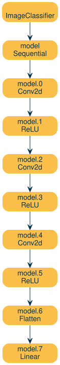
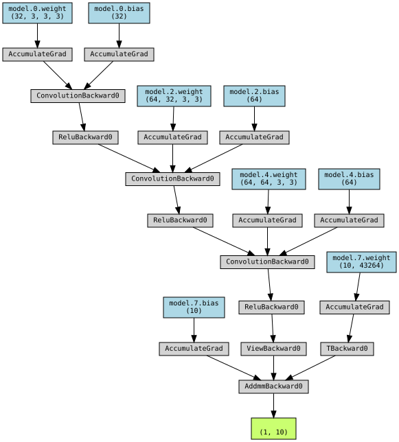

# Model Diagrams

Create any model into Diagrams

Author

Benedict Thekkel

## Neutral Network

``` python
import torch
import torch.nn as nn
import torch.nn.functional as F
import torchvision
import torchvision.transforms as transforms 
from torchvision.transforms import ToPILImage
import matplotlib.pyplot as plt
import numpy as np
```

``` python
device = torch.device('cuda' if torch.cuda.is_available() else 'cpu')
```

``` python
#Option 1 (create nn modules)
class NeuralNet2(nn.Module):
    def __init__(self, input_size, hidden_size, num_classes):
        super(NeuralNet2, self).__init__()
        self.linear1 = nn.Linear(input_size, hidden_size)
        self.relu = nn.ReLU()
        self.linear2 = nn.Linear(hidden_size, num_classes)
        self.sigmoid = nn.Sigmoid()
        

    def forward(self, x):
        out = self.linear1(x)
        out = self.relu(out)
        out = self.linear2(out)
        out = self.sigmoid(out)

        return out
```

``` python
# Image Classifier Neural Network
class ImageClassifier(nn.Module): 
    def __init__(self):
        super().__init__()
        self.model = nn.Sequential(
            nn.Conv2d(3, 32, (3,3)), 
            nn.ReLU(),
            nn.Conv2d(32, 64, (3,3)), 
            nn.ReLU(),
            nn.Conv2d(64, 64, (3,3)), 
            nn.ReLU(),
            nn.Flatten(), 
            nn.Linear(64*(28-2)*(28-2), 10)  
        )

    def forward(self, x): 
        return self.model(x)
```

``` python
model = ImageClassifier()
model
```

    ImageClassifier(
      (model): Sequential(
        (0): Conv2d(3, 32, kernel_size=(3, 3), stride=(1, 1))
        (1): ReLU()
        (2): Conv2d(32, 64, kernel_size=(3, 3), stride=(1, 1))
        (3): ReLU()
        (4): Conv2d(64, 64, kernel_size=(3, 3), stride=(1, 1))
        (5): ReLU()
        (6): Flatten(start_dim=1, end_dim=-1)
        (7): Linear(in_features=43264, out_features=10, bias=True)
      )
    )

``` python
for item in model.state_dict():
    print(f'{item}        size: {model.state_dict()[item].shape}')
```

    model.0.weight        size: torch.Size([32, 3, 3, 3])
    model.0.bias        size: torch.Size([32])
    model.2.weight        size: torch.Size([64, 32, 3, 3])
    model.2.bias        size: torch.Size([64])
    model.4.weight        size: torch.Size([64, 64, 3, 3])
    model.4.bias        size: torch.Size([64])
    model.7.weight        size: torch.Size([10, 43264])
    model.7.bias        size: torch.Size([10])

``` python
for param in model.parameters():
    print(param.shape)
```

    torch.Size([32, 3, 3, 3])
    torch.Size([32])
    torch.Size([64, 32, 3, 3])
    torch.Size([64])
    torch.Size([64, 64, 3, 3])
    torch.Size([64])
    torch.Size([10, 43264])
    torch.Size([10])

``` python
for child in model.children():
    print(child)
```

    Sequential(
      (0): Conv2d(3, 32, kernel_size=(3, 3), stride=(1, 1))
      (1): ReLU()
      (2): Conv2d(32, 64, kernel_size=(3, 3), stride=(1, 1))
      (3): ReLU()
      (4): Conv2d(64, 64, kernel_size=(3, 3), stride=(1, 1))
      (5): ReLU()
      (6): Flatten(start_dim=1, end_dim=-1)
      (7): Linear(in_features=43264, out_features=10, bias=True)
    )

``` python
a = 'sadf(asdf(123(123'
a.split('(', 1)
```

    ['sadf', 'asdf(123(123']

``` python
# Iterate through each layer in the model
for name, layer in model.named_modules():
    layer_name = str(layer).split('(', 1)[0]
    print(f'[name:{name}] layer:{layer_name}')
```

    [name:] layer:ImageClassifier
    [name:model] layer:Sequential
    [name:model.0] layer:Conv2d
    [name:model.1] layer:ReLU
    [name:model.2] layer:Conv2d
    [name:model.3] layer:ReLU
    [name:model.4] layer:Conv2d
    [name:model.5] layer:ReLU
    [name:model.6] layer:Flatten
    [name:model.7] layer:Linear

``` python
def create_model_diagram(model):
    from nbdevAuto.functions import graph
    from graphviz import Digraph
    dot = graph()
    dot.attr(rankdir='TB')

    for name, layer in model.named_modules():
        layer_name = str(layer).split('(', 1)[0]
        node = f'{name}\n{layer_name}'
        dot.node(node, node)

    for index, (name, layer) in enumerate(model.named_modules()):
        layer_name = str(layer).split('(', 1)[0]
        node = f'{name}\n{layer_name}'
        if index == 0:
            previous = node
            continue    
        
        dot.edge(previous, node)
        previous = node

    # Render the graph
    return dot
```

``` python
create_model_diagram(model)
```



``` python
from torchviz import make_dot
```

``` python
# Define a dummy input tensor
dummy_input = torch.randn(1, 3, 32, 32)

# Perform a forward pass
output = model(dummy_input)

# Visualize the model's forward structure
# This will create a graph representing the forward pass
graph = make_dot(output, params=dict(model.named_parameters()))
graph
```



``` python
graph.render("forward_structure", format="png", cleanup=True)
```

    'forward_structure.png'

Back to top
