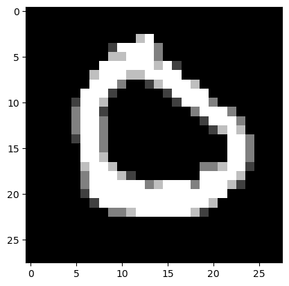
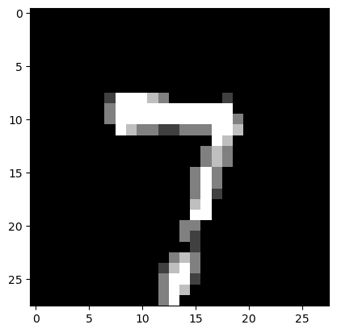
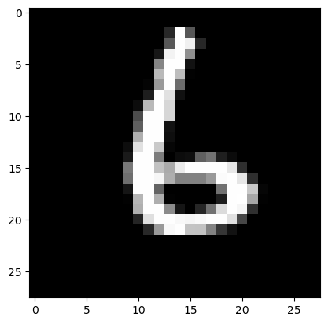
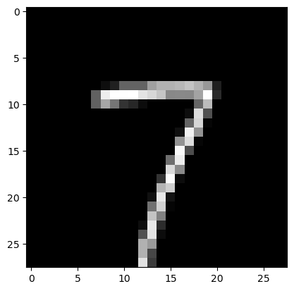

# Simple MNIST NN from scratch

Simple MNIST NN from scratch

Author

Benedict Thekkel

``` python
import numpy as np
import pandas as pd
from matplotlib import pyplot as plt
from torchvision import datasets
from tqdm.notebook import tqdm
```

``` python
# Import dependencies
import torch 
from PIL import Image
from torch import nn, save, load
from torch.optim import Adam
from torch.utils.data import DataLoader
from torchvision import datasets
from torchvision.transforms import ToTensor

# Get data 
train = datasets.MNIST(root="data", download=True, train=True)
```

``` python
m_data = train.data.reshape(60000, 28*28)
```

``` python
np_data = np.array(m_data)
target = np.array(train.targets)
```

``` python
data = np.insert(np_data, 0, target, axis=1)
```

``` python
np_data.shape, target.shape, data.shape
```

    ((60000, 784), (60000,), (60000, 785))

``` python
m, n = data.shape
np.random.shuffle(data) # shuffle before splitting into dev and training sets
```

``` python
data_dev = data[0:1000].T
Y_dev = data_dev[0]
X_dev = data_dev[1:n]
X_dev = X_dev / 255.

data_train = data[1000:m].T
Y_train = data_train[0]
X_train = data_train[1:n]
X_train = X_train / 255.
_,m_train = X_train.shape
```

``` python
Y_train
```

    array([0, 7, 6, ..., 6, 5, 3], dtype=uint8)

Our NN will have a simple two-layer architecture. Input layer $a^{[0]}$ will have 784 units corresponding to the 784 pixels in each 28x28 input image. A hidden layer $a^{[1]}$ will have 10 units with ReLU activation, and finally our output layer $a^{[2]}$ will have 10 units corresponding to the ten digit classes with softmax activation.

**Forward propagation**

$$Z^{[1]} = W^{[1]} X + b^{[1]}$$ $$A^{[1]} = g_{\text{ReLU}}(Z^{[1]}))$$ $$Z^{[2]} = W^{[2]} A^{[1]} + b^{[2]}$$ $$A^{[2]} = g_{\text{softmax}}(Z^{[2]})$$

**Backward propagation**

$$dZ^{[2]} = A^{[2]} - Y$$ $$dW^{[2]} = \frac{1}{m} dZ^{[2]} A^{[1]T}$$ $$dB^{[2]} = \frac{1}{m} \Sigma {dZ^{[2]}}$$ $$dZ^{[1]} = W^{[2]T} dZ^{[2]} .* g^{[1]\prime} (z^{[1]})$$ $$dW^{[1]} = \frac{1}{m} dZ^{[1]} A^{[0]T}$$ $$dB^{[1]} = \frac{1}{m} \Sigma {dZ^{[1]}}$$

**Parameter updates**

$$W^{[2]} := W^{[2]} - \alpha dW^{[2]}$$ $$b^{[2]} := b^{[2]} - \alpha db^{[2]}$$ $$W^{[1]} := W^{[1]} - \alpha dW^{[1]}$$ $$b^{[1]} := b^{[1]} - \alpha db^{[1]}$$

**Vars and shapes**

Forward prop

- $A^{[0]} = X$: 784 x m
- $Z^{[1]} \sim A^{[1]}$: 10 x m
- $W^{[1]}$: 10 x 784 (as $W^{[1]} A^{[0]} \sim Z^{[1]}$)
- $B^{[1]}$: 10 x 1
- $Z^{[2]} \sim A^{[2]}$: 10 x m
- $W^{[1]}$: 10 x 10 (as $W^{[2]} A^{[1]} \sim Z^{[2]}$)
- $B^{[2]}$: 10 x 1

Backprop

- $dZ^{[2]}$: 10 x m ($~A^{[2]}$)
- $dW^{[2]}$: 10 x 10
- $dB^{[2]}$: 10 x 1
- $dZ^{[1]}$: 10 x m ($~A^{[1]}$)
- $dW^{[1]}$: 10 x 10
- $dB^{[1]}$: 10 x 1

``` python
def init_params():
    W1 = np.random.rand(10, 784) - 0.5
    b1 = np.random.rand(10, 1) - 0.5
    W2 = np.random.rand(10, 10) - 0.5
    b2 = np.random.rand(10, 1) - 0.5
    return W1, b1, W2, b2

def ReLU(Z):
    return np.maximum(Z, 0)

def softmax(Z):
    A = np.exp(Z) / sum(np.exp(Z))
    return A
    
def forward_prop(W1, b1, W2, b2, X):
    Z1 = W1.dot(X) + b1
    A1 = ReLU(Z1)
    Z2 = W2.dot(A1) + b2
    A2 = softmax(Z2)
    return Z1, A1, Z2, A2

def ReLU_deriv(Z):
    return Z > 0

def one_hot(Y):
    one_hot_Y = np.zeros((Y.size, Y.max() + 1))
    one_hot_Y[np.arange(Y.size), Y] = 1
    one_hot_Y = one_hot_Y.T
    return one_hot_Y

def backward_prop(Z1, A1, Z2, A2, W1, W2, X, Y):
    one_hot_Y = one_hot(Y)
    dZ2 = A2 - one_hot_Y
    dW2 = 1 / m * dZ2.dot(A1.T)
    db2 = 1 / m * np.sum(dZ2)
    dZ1 = W2.T.dot(dZ2) * ReLU_deriv(Z1)
    dW1 = 1 / m * dZ1.dot(X.T)
    db1 = 1 / m * np.sum(dZ1)
    return dW1, db1, dW2, db2

def update_params(W1, b1, W2, b2, dW1, db1, dW2, db2, alpha):
    W1 = W1 - alpha * dW1
    b1 = b1 - alpha * db1    
    W2 = W2 - alpha * dW2  
    b2 = b2 - alpha * db2    
    return W1, b1, W2, b2
```

``` python
def get_predictions(A2):
    return np.argmax(A2, 0)

def get_accuracy(predictions, Y):
    print(predictions, Y)
    return np.sum(predictions == Y) / Y.size

def gradient_descent(X, Y, alpha, iterations):
    W1, b1, W2, b2 = init_params()
    for i in tqdm(range(iterations)):
        Z1, A1, Z2, A2 = forward_prop(W1, b1, W2, b2, X)
        dW1, db1, dW2, db2 = backward_prop(Z1, A1, Z2, A2, W1, W2, X, Y)
        W1, b1, W2, b2 = update_params(W1, b1, W2, b2, dW1, db1, dW2, db2, alpha)
        if i % 50 == 0:
            print("Iteration: ", i)
            predictions = get_predictions(A2)
            print(get_accuracy(predictions, Y))
    return W1, b1, W2, b2
```

``` python
W1, b1, W2, b2 = gradient_descent(X_train, Y_train, 0.20, 500)
```

    Iteration:  0
    [0 9 0 ... 0 0 5] [0 7 6 ... 6 5 3]
    0.1644406779661017
    Iteration:  50
    [0 7 6 ... 6 0 8] [0 7 6 ... 6 5 3]
    0.6483898305084745
    Iteration:  100
    [0 7 6 ... 6 5 7] [0 7 6 ... 6 5 3]
    0.7637118644067796
    Iteration:  150
    [0 7 6 ... 6 5 7] [0 7 6 ... 6 5 3]
    0.810322033898305
    Iteration:  200
    [0 7 6 ... 6 5 7] [0 7 6 ... 6 5 3]
    0.8343559322033899
    Iteration:  250
    [0 7 6 ... 6 5 7] [0 7 6 ... 6 5 3]
    0.8489322033898306
    Iteration:  300
    [0 7 6 ... 6 5 7] [0 7 6 ... 6 5 3]
    0.8593050847457627
    Iteration:  350
    [0 7 6 ... 6 5 7] [0 7 6 ... 6 5 3]
    0.8668135593220339
    Iteration:  400
    [0 7 6 ... 6 5 7] [0 7 6 ... 6 5 3]
    0.8729491525423729
    Iteration:  450
    [0 7 6 ... 6 5 7] [0 7 6 ... 6 5 3]
    0.8777457627118644

~85% accuracy on training set.

``` python
def make_predictions(X, W1, b1, W2, b2):
    _, _, _, A2 = forward_prop(W1, b1, W2, b2, X)
    predictions = get_predictions(A2)
    return predictions

def test_prediction(index, W1, b1, W2, b2):
    current_image = X_train[:, index, None]
    prediction = make_predictions(X_train[:, index, None], W1, b1, W2, b2)
    label = Y_train[index]
    print("Prediction: ", prediction)
    print("Label: ", label)
    
    current_image = current_image.reshape((28, 28)) * 255
    plt.gray()
    plt.imshow(current_image, interpolation='nearest')
    plt.show()
```

Let’s look at a couple of examples:

``` python
test_prediction(0, W1, b1, W2, b2)
test_prediction(1, W1, b1, W2, b2)
test_prediction(2, W1, b1, W2, b2)
test_prediction(3, W1, b1, W2, b2)
```

    Prediction:  [0]
    Label:  0



    Prediction:  [7]
    Label:  7



    Prediction:  [6]
    Label:  6



    Prediction:  [7]
    Label:  7



Finally, let’s find the accuracy on the dev set:

``` python
dev_predictions = make_predictions(X_dev, W1, b1, W2, b2)
get_accuracy(dev_predictions, Y_dev)
```

    [1 0 1 9 9 0 3 4 5 3 8 0 3 9 1 4 6 7 0 3 7 5 2 1 0 0 2 5 7 0 9 2 5 0 2 8 8
     5 2 3 2 3 6 5 6 5 6 5 1 7 1 7 5 7 4 9 7 7 1 3 2 5 9 9 6 4 1 6 7 7 1 5 1 6
     2 5 0 9 7 2 5 3 4 0 7 7 5 0 7 9 6 4 5 3 1 9 0 2 1 2 0 2 5 5 4 1 8 9 1 5 2
     5 3 4 2 0 2 5 0 0 4 0 3 0 7 0 0 8 4 1 7 6 3 5 0 4 6 6 1 3 8 9 1 5 6 6 1 7
     6 2 5 8 9 7 6 9 0 7 6 4 7 1 2 9 9 4 2 0 7 1 4 5 8 0 7 9 2 0 4 6 6 4 2 7 7
     0 4 7 0 9 4 6 7 6 2 4 5 1 8 1 3 2 0 4 4 7 1 2 8 2 2 3 3 7 7 9 5 1 6 1 0 7
     4 0 6 0 6 1 9 8 7 0 5 4 7 7 5 0 2 6 6 1 7 8 2 9 7 3 5 1 6 2 8 1 0 4 7 6 8
     6 6 0 7 7 7 0 0 9 6 0 8 6 6 8 6 6 8 8 0 8 7 1 8 4 5 8 2 2 5 0 1 9 0 7 3 0
     3 9 2 0 6 9 8 9 5 7 7 5 2 7 7 9 3 3 6 8 3 8 5 3 9 1 8 0 4 5 9 9 6 2 1 4 4
     0 0 9 9 1 6 3 1 7 3 7 4 6 2 9 1 0 3 2 1 1 4 8 1 2 8 4 8 7 6 4 1 3 7 7 0 3
     0 6 2 6 6 5 2 9 2 7 8 8 0 0 0 7 0 1 2 2 4 0 4 1 5 4 8 0 8 8 8 8 4 5 4 1 9
     6 5 6 4 3 8 1 3 6 9 6 7 9 9 6 3 5 1 5 1 4 1 1 9 4 0 6 4 3 8 7 9 5 1 7 0 7
     7 2 3 5 7 8 8 4 7 6 8 1 4 7 8 9 4 3 6 0 4 5 7 4 4 5 8 4 6 5 8 3 1 2 5 5 5
     6 1 9 7 6 0 3 7 4 1 8 2 4 8 8 1 4 9 7 3 9 2 1 1 8 2 6 7 2 6 6 1 0 0 1 9 3
     9 8 3 9 6 7 6 8 4 6 3 9 4 8 4 1 9 8 2 5 4 4 3 5 7 1 3 7 1 6 4 6 1 7 5 7 5
     9 9 6 3 0 1 6 1 8 0 8 8 0 6 2 8 7 3 1 8 6 9 6 7 1 0 3 3 1 3 7 4 9 0 4 9 0
     3 3 1 4 7 4 0 7 4 0 1 5 2 2 7 2 7 7 5 4 3 2 8 3 5 7 9 3 5 2 0 8 1 9 4 1 4
     9 9 1 3 1 3 9 7 0 1 3 4 0 5 2 9 8 3 8 9 0 5 1 7 1 5 5 9 6 9 1 1 8 1 1 6 2
     0 7 1 5 2 2 1 8 2 7 7 1 4 6 0 2 2 1 4 0 6 2 1 2 0 3 6 7 6 3 6 7 9 0 7 7 9
     7 5 2 2 8 6 7 8 0 3 0 1 4 5 3 6 1 3 9 1 6 1 8 3 7 3 1 5 3 5 0 1 4 0 9 0 0
     8 5 9 8 0 2 4 9 1 2 1 8 3 6 4 2 4 1 1 2 3 2 7 5 4 2 5 0 6 3 0 4 4 7 9 3 8
     0 3 6 1 0 1 8 3 6 5 7 0 5 3 3 4 7 7 2 7 1 3 4 7 0 1 2 3 8 4 3 8 0 0 7 6 8
     6 1 6 2 3 2 8 2 3 1 0 2 8 3 3 0 3 1 2 0 1 1 6 4 0 1 7 9 4 2 8 6 7 9 1 7 7
     3 1 8 8 8 9 4 0 7 0 3 1 6 1 1 5 4 8 4 7 5 9 0 3 1 0 1 7 6 1 0 6 4 1 8 2 4
     2 5 5 6 7 8 4 5 7 6 7 2 1 8 1 5 0 3 8 2 1 0 4 1 9 9 5 6 9 6 1 9 2 3 9 9 7
     6 9 9 7 7 1 0 9 3 3 2 1 8 3 0 8 9 5 3 1 9 1 5 1 3 6 0 7 4 6 1 2 7 9 5 1 2
     0 3 5 1 7 4 7 3 8 5 6 4 6 1 4 1 6 5 5 5 1 0 0 2 6 2 8 4 0 6 7 7 0 7 6 1 3
     0] [1 0 1 9 8 0 3 4 5 3 8 0 3 9 1 4 6 7 0 3 2 3 8 1 5 0 2 5 7 0 9 2 6 0 2 6 8
     5 2 3 2 3 6 5 6 5 6 5 1 7 1 7 8 7 4 9 3 7 1 3 2 3 8 9 6 9 1 6 7 7 1 5 1 6
     2 5 0 4 7 2 5 3 4 7 7 7 5 0 7 9 6 4 5 3 1 7 0 6 1 2 0 2 5 5 4 1 8 9 1 5 2
     5 5 9 2 0 7 8 0 0 4 0 3 0 7 5 0 8 4 1 7 6 3 5 2 4 6 6 1 8 8 4 1 5 6 6 1 7
     6 2 3 8 9 7 6 9 0 7 6 4 7 1 2 9 9 4 2 0 7 1 4 5 8 0 7 9 2 0 4 4 6 4 2 7 7
     0 4 7 0 7 4 6 7 6 7 4 1 1 8 1 3 2 0 4 4 7 1 2 8 2 2 3 3 7 7 9 5 1 6 1 0 7
     4 0 6 0 6 1 9 8 9 0 5 4 1 9 5 0 2 6 2 1 7 8 2 9 7 3 5 1 6 2 8 1 0 8 7 6 8
     6 6 0 7 7 7 8 0 9 6 0 8 6 6 8 6 6 8 2 0 8 7 1 8 4 5 8 2 2 8 2 1 9 0 7 5 7
     0 9 2 0 6 7 8 9 3 7 7 8 2 7 9 9 3 8 4 4 3 8 5 3 9 2 8 0 6 5 9 9 6 2 1 4 4
     0 0 9 9 1 6 3 1 7 3 7 4 6 8 9 7 0 3 2 1 1 2 6 1 2 8 4 8 7 6 6 1 3 7 7 0 3
     0 6 2 6 6 5 2 9 2 7 8 8 0 0 0 7 0 1 2 2 4 0 6 1 5 4 8 0 8 2 8 8 4 3 0 1 9
     6 5 4 4 3 8 1 3 6 9 6 7 9 9 6 5 8 1 5 1 4 1 1 9 4 2 5 4 3 8 7 9 3 1 7 0 9
     7 2 3 5 2 8 8 4 9 6 8 1 4 7 8 9 4 3 6 0 4 5 7 4 4 5 8 4 6 5 3 3 1 2 5 5 5
     6 1 9 7 6 0 3 7 4 1 8 7 4 8 8 1 7 9 3 3 4 2 8 5 8 7 6 7 1 6 6 1 0 2 1 9 3
     9 8 3 9 5 7 6 4 4 6 3 9 5 8 4 1 9 8 8 3 4 4 3 5 7 1 3 7 1 6 4 6 1 2 5 7 5
     5 9 6 3 0 1 6 1 8 0 8 8 0 6 2 5 7 3 8 8 6 9 4 7 1 0 3 1 1 3 7 4 9 0 4 9 0
     3 3 1 4 7 4 0 7 4 0 1 5 2 2 7 2 7 5 3 4 9 2 8 5 5 7 4 3 5 1 0 8 1 9 4 1 4
     9 4 1 3 1 3 9 7 0 1 3 4 0 7 8 9 8 3 5 9 0 5 1 7 1 8 5 9 6 9 1 1 8 1 1 6 2
     0 7 1 5 2 2 1 8 2 2 5 1 4 6 0 2 2 1 4 0 6 2 1 2 0 3 6 7 6 3 6 7 9 0 9 7 9
     7 5 2 2 8 6 7 8 0 3 0 1 4 5 3 6 1 3 4 1 6 4 8 3 7 3 2 5 3 3 0 1 4 0 9 0 0
     8 3 9 8 0 2 9 9 1 2 1 8 3 6 4 7 4 1 1 2 3 2 7 5 4 2 5 0 6 3 0 4 4 7 9 3 2
     0 3 6 1 0 8 8 8 6 5 7 0 5 8 8 4 3 7 0 7 1 7 4 7 0 4 7 3 8 4 3 8 0 0 7 2 2
     6 1 6 2 3 2 8 5 9 1 9 2 8 3 3 0 3 1 2 0 1 1 6 4 0 1 7 9 4 2 8 6 7 9 8 7 9
     3 1 8 3 8 9 4 0 7 0 3 1 6 1 1 5 5 8 4 7 5 9 0 3 1 0 1 7 6 1 0 6 4 1 8 2 4
     2 8 8 6 7 8 4 5 7 6 7 6 1 8 1 5 0 3 8 2 1 0 9 1 5 9 5 6 9 6 1 9 2 3 7 9 2
     6 9 9 7 7 1 0 9 8 3 2 1 5 3 0 8 7 3 3 1 9 1 4 1 3 6 0 7 4 6 1 2 7 9 5 1 3
     0 3 5 1 7 4 7 3 8 5 6 4 6 1 4 1 6 5 5 5 1 2 0 2 6 2 8 4 0 6 7 7 0 7 6 1 3
     7]

    0.856

Still 84% accuracy, so our model generalized from the training data pretty well.

Back to top
